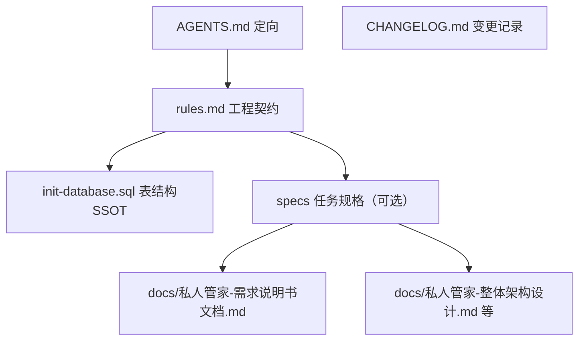

# AI 执行层文档（docs/ai）

> 面向 AI 日常协作的 SSOT 与可执行文档。与 `docs/` 传统设计文档**共存、单向引用**：AI 执行层引用传统文档与 SSOT，传统文档不反向依赖。

## 组成与读写时机
| 文件 | 作用 | 何时读 / 写 |
| :-- | :-- | :-- |
| `/AGENTS.md` | 新会话定向（项目地图、服务端口、构建测试、SSOT 指引） | 每次新会话先读 |
| `docs/ai/rules.md` | 工程契约 / 红线（14 类） | 任何改动前必读；红线变更时更新 |
| `/CHANGELOG.md` | 变更记录（改了什么/为什么/影响范围） | 每次改动后登记 |
| `docs/ai/specs/` | 结构化任务规格（可选，按需建立） | 大型需求开工前，用 `规格-<主题>.md` 切片 |
| `docs/ai/evals/` | 黄金评测集（可选，按需建立） | 改核心行为后跑/补用例（如状态机、周期任务生成、导入导出） |

## 新会话推荐阅读顺序
`AGENTS.md` → `rules.md` → 相关任务规格（如有）→ 涉及的代码与测试 → `CHANGELOG.md`（近期变更）

## 引用关系（单向）

- 表结构：一律引用 `righthand-go/sql/init-database.sql`（唯一权威），不复制 DDL
- 需求：引用 `docs/私人管家-需求说明书文档.md` 章节，不复制
- 设计：`docs/私人管家-整体架构设计.md`、`docs/私人管家-详细方案设计.md` 为 V1.0 基线，细节以代码为准
- 部署：`docs/私人管家-部署指南.md`

## 维护约定（红线级）
- **冷热分离**：本目录与其他热文档（代码/测试/`init-database.sql`/`CHANGELOG.md`）每次改动实时更新；`docs/` 传统设计文档为冷文档，里程碑/交付节点根据 `CHANGELOG` 批量回填。详见 `rules.md` §12
- 表结构变更 → 改 `init-database.sql`（不新增独立增量脚本）
- 红线变更 → 改 `rules.md`
- 核心行为变更 → 先补/跑测试（状态机、周期生成、权限、导入导出、中文编码）
- 任何改动 → 登记 `CHANGELOG.md`
- 命名：`specs/`、`evals/` 内容文件用中文名（`规格-<主题>.md` / `评测-<主题>.md`）；约定入口 `AGENTS.md`/`README.md`/`CHANGELOG.md`/`rules.md` 保留英文

## 落地进度
- P1（AGENTS + rules + 本索引 + CHANGELOG）已完成
- P2（specs 模板 + 首批任务规格）待按需建立
- P3（evals：状态机 / 周期任务生成 / 中文编码黄金用例）待按需建立
